# LAPORAN PRAKTIKUM 8
## PHP dan Database MySQL

### 1. Identitas Praktikum
- **Mata Kuliah:** Pemrograman Web
- **Praktikum:** 8
- **Nama:** Fahreza Bintang Mahesa
- **NIM:** 312110220

### 2. Langkah-Langkah Praktikum

#### Langkah 1 — Menjalankan XAMPP
Menjalankan Apache dan MySQL melalui XAMPP Control Panel agar aplikasi PHP dapat diakses dan terhubung ke database.

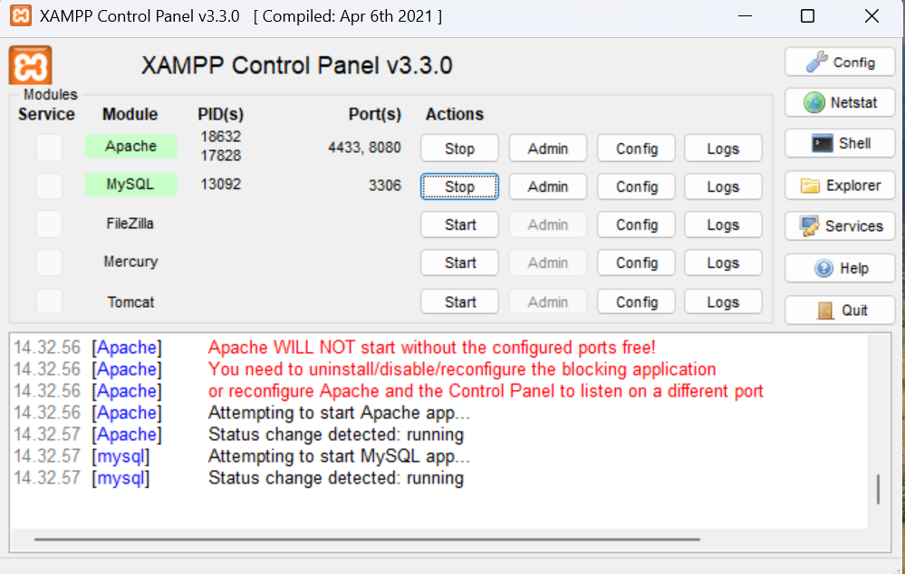

#### Langkah 2 — Membuat Database
Membuka phpMyAdmin melalui `http://localhost/phpmyadmin/`, kemudian membuat database dengan nama `latihan1`.
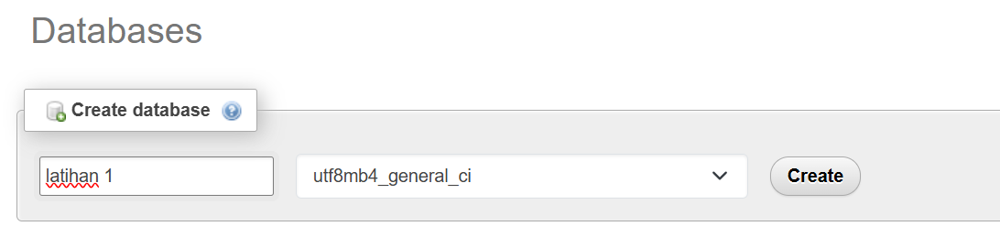

#### Langkah 3 — Membuat Tabel data_barang
Membuat tabel `data_barang` dengan kolom `id_barang`, `kategori`, `nama`, `gambar`, `harga_beli`, `harga_jual`, dan `stok`. Kolom `id_barang` menjadi primary key dan auto increment. Kolom `gambar` boleh bernilai NULL karena gambar bersifat opsional.
kemudian Memasukkan tiga data barang awal, yaitu HP Samsung Android, HP Xiaomi Android, dan HP OPPO Android, untuk menguji proses menampilkan data.
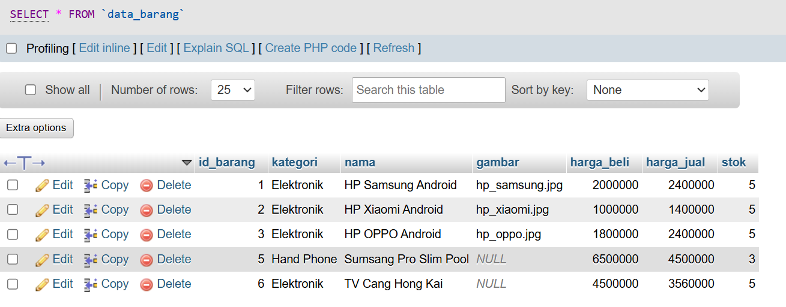

#### Langkah 5 — Membuat Folder Project
Membuat folder `lab8_php_database` di dalam direktori `htdocs` XAMPP sebagai tempat menyimpan file aplikasi.
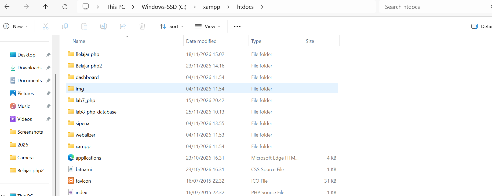

#### Langkah 6 — Membuat Koneksi Database
Membuat file `koneksi.php` untuk menghubungkan PHP dengan MySQL menggunakan `mysqli_connect()`. Program akan menampilkan pesan kesalahan jika koneksi gagal.
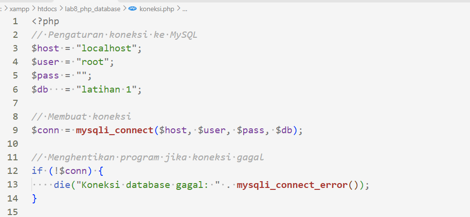

#### Langkah 7 — Menampilkan Data (Read)
Membuat `index.php` yang menjalankan query `SELECT` untuk mengambil data barang dari database dan menampilkannya dalam tabel HTML.
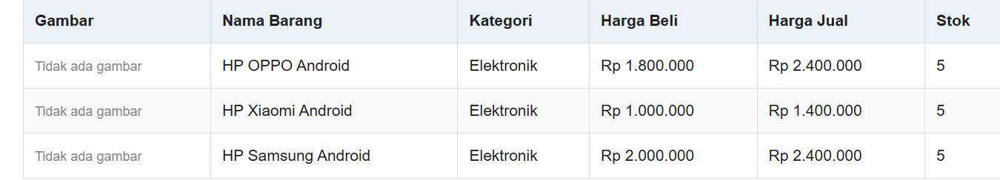

#### Langkah 8 — Menambah Data (Create)
Membuat `tambah.php` berisi formulir data barang. Data dikirim menggunakan POST dan disimpan ke database dengan query `INSERT`. Gambar dapat diunggah secara opsional.

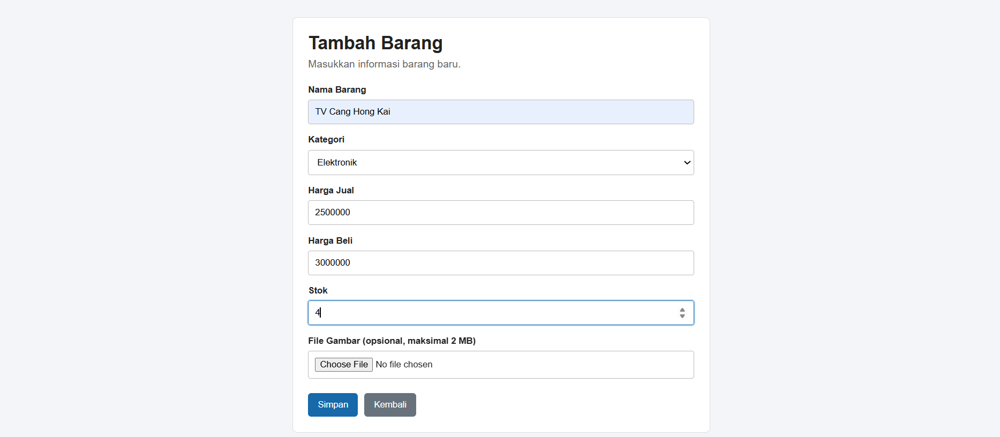

#### Langkah 9 — Mengubah Data (Update)
Membuat `ubah.php` untuk mengambil data berdasarkan `id_barang`, menampilkan data lama pada formulir, dan menyimpan perubahan menggunakan query `UPDATE`.

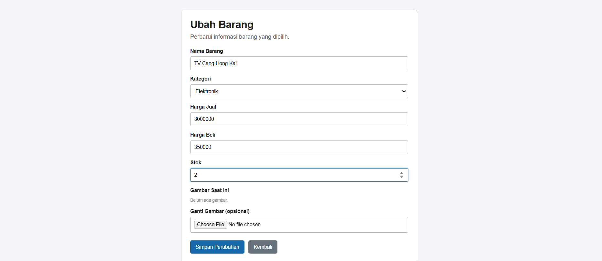

#### Langkah 10 — Menghapus Data (Delete)
Membuat `hapus.php` untuk menghapus data berdasarkan `id_barang` menggunakan query `DELETE`, kemudian kembali ke halaman utama.

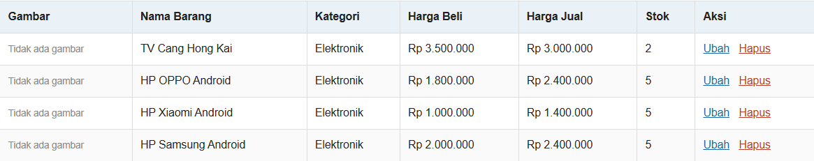
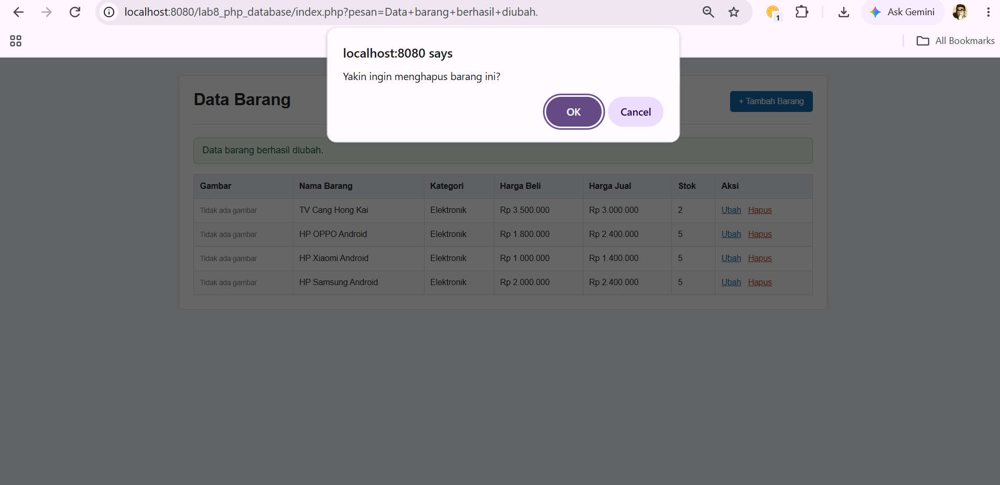
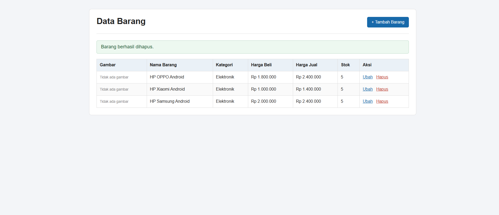


### 3. Struktur Folder
```text
lab8_php_database/
├── gambar/
├── koneksi.php
├── index.php
├── tambah.php
├── ubah.php
├── hapus.php
└── style.css
```

### 4. Kesimpulan
Praktikum ini menunjukkan bahwa PHP dapat digunakan untuk mengelola data pada MySQL. Aplikasi menerapkan empat operasi CRUD, yaitu Create (menambah), Read (menampilkan), Update (mengubah), dan Delete (menghapus) data barang. Praktikum juga melatih penggunaan koneksi database, query SQL, formulir, dan upload gambar.

### 5. Repository
**URL GitHub:** [https://github.com/fahrezabm2801-coder/Lab8Web.git]
